  

  
  
  

---

## 👋 About Me

AI engineer working across **model development** and the **infrastructure that puts models into production**.

- 🤖 &nbsp;Built an **agentic RAG assistant** with a ReAct reasoning loop and four integrated tools on top of a Thai LLM
- ⚡ &nbsp;Optimized a **Vision Transformer** with ONNX INT8 quantization for a **73% latency reduction**, shipped through automated CI/CD
- 🐳 &nbsp;Administer **self-hosted Docker infrastructure** running production workloads for two business units
- 🎓 &nbsp;B.Eng. in Artificial Intelligence Engineering and Data Science, **Bangkok University** (2022 – 2026)

---

## 🚀 Featured Projects

### 📈 [Agentic RAG — Stock Investment Assistant](https://github.com/chinnawat2424/Agentic-RAG-Stock-Investment-Assistant)

- AI agent with a **ReAct reasoning loop** over the Typhoon v2.5 LLM, answering multi-step questions that combine retrieved context with live market data
- **Four agent tools:** semantic search over ChromaDB, live news retrieval, financial ratio calculation and real-time price lookup via yfinance
- Containerized Flask service on Hugging Face Spaces, with **multilingual embeddings** for Thai and English queries

### 🍜 [Food Vision API — MLOps Image Classification Service](https://github.com/chinnawat2424/food_ai)

- Converted a **Vision Transformer** from PyTorch to ONNX with **INT8 quantization**: model size **−75%**, CPU latency **−73%**, accuracy loss **under 1%**
- Async **FastAPI** serving layer with ProcessPoolExecutor for CPU-bound inference and layered input validation
- Automated testing and deployment with **GitHub Actions** and **Docker**, load-tested with **Apache JMeter**

### 🧰 More Projects

| Project | Focus |
|:--|:--|
| [End-to-End MLOps Pipeline](https://github.com/chinnawat2424/End-to-End-MLOps-Pipeline-) | Machine-learning pipeline from training to deployment |
| [ML Model Deployment](https://github.com/chinnawat2424/ML-Model-Deployment) | Quantized ONNX model served via FastAPI, with pytest, Docker and GitHub Actions |
| [RAG](https://github.com/chinnawat2424/RAG) | Retrieval-augmented generation experiments in Python |

---

## 💼 Experience

**Engineering Intern — Siam Win Engineering and Supply Co., Ltd.** &nbsp;·&nbsp; *May – Jun 2026*

- Deployed and maintained a production web system on **self-hosted Docker**, with separate production and development environments
- Developed a full-stack Thai-language **quotation & BOQ system** (Next.js 14, Prisma, PostgreSQL) managing **5,700+ customers** and **5,300+ products** across two business units
- Built print-accurate A4 **PDF generation with Puppeteer**, including custom pagination and Thai typography
- Added revision history and per-user document numbering to keep quotation workflows auditable
- Administered a **Synology NAS** with a three-tier backup strategy for all company data
- Recovered legacy accounting data by **reverse-engineering** an obsolete proprietary database format in Python

---

## 🛠️ Tech Stack

  
   
  

| Area | Skills |
|:--|:--|
| **AI / ML** | LLM integration, Agentic RAG (ReAct), tool calling, ChromaDB, FAISS, embeddings, PyTorch, Vision Transformer, YOLO |
| **ML Serving & Optimization** | ONNX Runtime, INT8 quantization, FastAPI, async inference, model artifact management, Hugging Face Spaces |
| **Infrastructure & DevOps** | Docker, Docker Compose, GitHub Actions (CI/CD), Linux, Git, Git LFS, self-hosted deployment |
| **Testing & Performance** | pytest, Apache JMeter, load testing, latency profiling |
| **Languages** | Python, TypeScript, JavaScript, SQL |
| **Databases** | PostgreSQL, MySQL, SQLite |
| **Frameworks** | FastAPI, Flask, Next.js, React, Node.js, Prisma ORM |

---

## 📜 Certifications & Activities

- 🏅 **Agentic AI with LangChain and LangGraph** — IBM, Coursera
- 🏅 **Transforming Exploratory Data Analysis with AI** — Coursera
- 🏅 **Creating Impactful Data Visualizations with Generative AI** — Coursera
- 🏅 **Microsoft Copilot for Power BI: AI-Powered Report Insights** — Coursera
- 🐘 **Technical Staff**, AI Hackathon: Elephant Identification 2025 — Bangkok University (Oct 2025)

---

## 📊 GitHub Stats

  
  

Open to conversations about LLM applications, RAG and deploying ML to production.

